# WorkBuddy Market

**简体中文** · [English](README_EN.md)

[](https://github.com/zjs105910/workbuddy-market/actions/workflows/ci.yml)
[](https://pypi.org/project/workbuddy-market/)
[](https://pypi.org/project/workbuddy-market/)
[](pyproject.toml)
[](LICENSE)

**给 WorkBuddy 用的本机优先插件市场。** 将本机 Skills 打包成插件，在精选社区目录或 GitHub 中查找技能；安装前查看来源、权限声明和兼容性，再通过哈希校验与可恢复事务完成安装、更新和卸载。

*A local-first plugin marketplace for WorkBuddy: package local Skills, explore community and GitHub sources, review declared permissions and compatibility, and manage installs through hash verification and recoverable transactions.*

## 🚀 一句话安装（Windows 10/11）

想通过视频评论区快速安装？打开 **Windows PowerShell**，复制并执行下面这一整行：

```powershell
$ErrorActionPreference='Stop'; $u='https://github.com/zjs105910/workbuddy-market/releases/latest/download/install.cmd'; $f=Join-Path $env:TEMP 'workbuddy-market-install.cmd'; Invoke-WebRequest -UseBasicParsing -Uri $u -OutFile $f; if ((Get-Item $f).Length -lt 1000) { throw '安装器下载不完整；请前往 https://github.com/zjs105910/workbuddy-market/releases/latest 手动下载 install.cmd' }; & $env:ComSpec /d /c "call `"$f`""
```

- **安装后怎么选？** 首次向导中，直接按回车是只浏览；输入 `2` 才会注册到 WorkBuddy。
- **不想粘贴命令？** [直接下载 install.cmd 后双击运行](https://github.com/zjs105910/workbuddy-market/releases/latest/download/install.cmd)。
- **先检查再运行？** [查看安装脚本源码](https://github.com/zjs105910/workbuddy-market/blob/main/install.cmd)。

> 此命令会下载并运行本项目公开的安装脚本。需要 Windows 10/11、可访问 GitHub 和 Python 包源的网络环境；网络限制、设备策略或 Python 安装失败等情况仍可能导致安装中断。

## 30 秒了解它

- **管理自己的 Skills**：将本机技能打包、同步，并注册到 WorkBuddy 插件面板。
- **发现社区技能**：浏览精选目录，也可以搜索 GitHub 上的公开仓库。
- **安装过程更可追溯**：安装前有来源与风险预览；支持内容校验、事务恢复和回收站。
- **本机优先**：网页服务只监听 `127.0.0.1`；你的私有市场配置和本机技能内容不随仓库提交。



> 架构一图流：CLI 负责注册与分发，Web UI（仅 `127.0.0.1`）经哈希校验与事务回收站装卸技能，社区目录与版本分发来自 GitHub 与 PyPI。更多图见 [docs/diagrams/](docs/diagrams/)（[安装前防线](docs/diagrams/wbm-install-flow.html) · [三方发版同步](docs/diagrams/wbm-release-sync.html)）。

## 演示与下载

先看约 80 秒的可复现产品演示，再选择适合你的安装方式。正式版 Release 会同时提供横屏与竖屏演示视频、字幕、manifest、Python 安装包和 SHA-256 校验文件。

- **先看演示**：[横屏 MP4（16:9）](https://github.com/zjs105910/workbuddy-market/releases/latest/download/workbuddy-market-demo.mp4) · [竖屏 MP4（9:16）](https://github.com/zjs105910/workbuddy-market/releases/latest/download/workbuddy-market-demo-vertical.mp4) · [中文字幕（SRT）](https://github.com/zjs105910/workbuddy-market/releases/latest/download/workbuddy-market-demo.zh-CN.srt)
- **安装完整版**：[最新版正式 Release](https://github.com/zjs105910/workbuddy-market/releases/latest)（含 Windows 安装器、wheel、sdist 和 `SHA256SUMS.txt`）；Windows 用户也可[直接下载 `install.cmd`](https://github.com/zjs105910/workbuddy-market/releases/latest/download/install.cmd)。
- **只装精选技能**：继续看下方「只想装精选技能（zip 导入）」；这是轻量分发入口，不包含完整版的安装前安全预览与可恢复卸载。
- **了解生成与安全边界**：[可复现演示的录制方法、字幕与隐私边界](docs/demo-video.md) · [正式 Release 发布流程](docs/release-process.md)

> `registry-artifacts-*` 是每日生成的社区插件产物预发布条目，不是市场本体。请认准标题为 `WorkBuddy Market vX.Y.Z` 的正式 Release；校验附件时，可在同一页面下载 `SHA256SUMS.txt`。

## 快速上手（Windows）

### 一键安装（Windows 10/11）

上方已提供可复制的一句话 PowerShell 安装命令。也可以[直接下载 install.cmd](https://github.com/zjs105910/workbuddy-market/releases/latest/download/install.cmd) 后双击运行。安装器会检测/安装 Python、安装或升级 CLI、下载市场本体并运行体检；首次向导中回车=只浏览，输入 `2`=注册进 WorkBuddy。

### 没有 Git？三步跑起来（免 Git，需 Python 3.10+） ✅

> 1. **下载**：打开 [Releases 最新版](https://github.com/zjs105910/workbuddy-market/releases/latest)（认准标题为 `WorkBuddy Market vX.Y.Z` 的条目；`registry-artifacts-*` 是插件产物 Pre-release，不是本体），点 **Source code (zip)**（或直接下 [main 分支 ZIP](https://github.com/zjs105910/workbuddy-market/archive/refs/heads/main.zip)）；
> 2. **解压**：右键解压到任意目录（路径不要含特殊字符）；
> 3. **双击**：双击 `安全模式-只开网页.cmd` 先浏览市场；准备好接入 WorkBuddy 时再双击 `一键启动.cmd`。

需要 Python 3.10+（首次启动向导会检测并给出明确提示）。配置文件不需要手工创建——首次启动自动初始化。

### 已经在用 CodeBuddy Code / WorkBuddy？一两条命令接入 ✅

在对话框（或 CodeBuddy Code CLI）执行：

```
/plugin marketplace add zjs105910/workbuddy-market
```

这是仓库**自带插件市场**（随 `bundled/` 目录入库固定，零漂移），装好后 `/plugin` 浏览，`/plugin install <插件名>@workbuddy-market` 安装。

想要**每日重建的完整社区目录**（25+ 精选技能，按人工审核的 sourceCommit 固定来源）：

```
/plugin marketplace add https://github.com/zjs105910/workbuddy-market.git#marketplace
```

`/plugin marketplace update` 即可刷新；不想用命令也可以走下面的 zip 导入。两条轻量入口的取舍见下方说明与 [FAQ 第八节](docs/FAQ.md)。

### 只想装精选技能（zip 导入）

不想跑任何工具，只想装社区精选技能：下载 [精选市场 zip](https://github.com/zjs105910/workbuddy-market/releases/download/marketplace/workbuddy-marketplace.zip)，在 **WorkBuddy 插件面板 → 添加自定义市场** 里选这个 zip 即可。内容每日由 CI 从人工审核的注册表自动重建。

> 入口适用范围：上述 zip 导入在 **WorkBuddy 桌面端（5.7.6 实测）插件面板**验证；CodeBuddy Code 的市场入口（`marketplace.json` URL / Git 仓库 / 本地路径）是不同客户端的路线，不支持直接导入本 zip——用 CodeBuddy Code 请改走 pipx 安装完整市场后注册。

> 这是精选目录的**轻量子集**：仓库体积超 30MB、含符号链接或没有标准 skill 结构的收录条目不会进包（搜不到某技能多半是这个原因）。完整清单见 zip 内 `.codebuddy-plugin/marketplace.json` 的 `included` / `excluded` 字段，或 Release 附件里的 manifest。

> 取舍说明：这条路拿到的是**技能分发**——没有安装前四问、所有权分级和可恢复卸载。要完整的安全链路，请用上面的完整版。

### 会用命令行？一条命令安装 ✅

```bash
pipx install workbuddy-market
workbuddy-market doctor     # 体检；list / search 逛社区目录
```

（需要先装 [pipx](https://pipx.pypa.io/)；`uv tool install workbuddy-market` 等价。）

### 用 Git 的话

```powershell
git clone https://github.com/zjs105910/workbuddy-market.git
cd workbuddy-market
.\安全模式-只开网页.cmd
```

启动后打开本机地址（默认 `http://127.0.0.1:8777/`）。**请保持启动窗口打开**；结束时回到窗口按 `Ctrl+C`。

已经准备好要接入 WorkBuddy 时，再运行 `一键启动.cmd`。首次初始化的交互向导中，**直接回车是只浏览**；只有明确输入 `2` 才会请求注册到 WorkBuddy。注册前仍会进行打包与自检前置检查。

不会使用命令行？克隆仓库后，也可以在资源管理器中双击 `安全模式-只开网页.cmd`。想了解其他启动参数、插件配置或 CLI，请看[详细使用与技术参考](ADVANCED_GUIDE.md)。

## 已收录插件

<!-- registry-table:start -->

> 共 **110** 个收录条目，由每日 CI 从人工审核的注册表自动刷新本表格。

| 插件 | 说明 | 分类 | 信任级 |
| --- | --- | --- | --- |
| [Anthropic 官方技能集](https://github.com/anthropics/skills) | Anthropic 官方 Agent Skills 仓库，含文档处理（docx/pdf/pptx/xlsx）、前端设计、MCP 构建、画布设计、品牌规范等 19 个高质量技能。 | 官方 | 官方 |
| [Superpowers 工程方法论](https://github.com/obra/superpowers) | 一套成体系的软件开发方法论技能包：头脑风暴、写计划、TDD、系统化调试、并行派发子代理、代码审查、收尾分支等 15 个技能，彼此衔接成工作流。 | 开发工具 | 已审 |
| [Matt Pocock 工程技能集](https://github.com/mattpocock/skills) | 知名 TypeScript 教育家 Matt Pocock 从自己的 .agents 目录里拿出来的工程技能集：面向真实工程场景的编码、评审与协作技能。 | 开发工具 | 已审 |
| [GStack 创业指挥栈](https://github.com/garrytan/gstack) | Y Combinator 总裁 Garry Tan 公开的 Claude Code 配置：CEO、设计师、工程管理等 23 个观点鲜明的工具，把 AI 当成完整创业团队来指挥。 | 开发工具 | 已审 |
| [Addy Osmani 工程技能](https://github.com/addyosmani/agent-skills) | Chrome 工程负责人 Addy Osmani 出品的 AI 编码智能体生产级技能集，覆盖调试、性能、架构与代码质量等方向。 | 开发工具 | 已审 |
| [Open Design 设计插件](https://github.com/nexu-io/open-design) | 开源的 DSH 设计插件替代品（对标 Claude Design）：本地优先的设计能力，让智能体直接产出可用的界面与视觉稿。 | 设计 | 已审 |
| [Taste 品味技能](https://github.com/Leonxlnx/taste-skill) | 给 AI 一双「好品味」的眼睛：阻止它生成平庸、模板化、千篇一律的输出，让界面与文案更有设计感（含安装脚本与示例）。 | 设计 | 已审 |
| [AI Scientist 科研技能库](https://github.com/K-Dense-AI/scientific-agent-skills) | 面向科研场景的 Agent 技能库：把 AI 智能体用于科研工作流，覆盖数据分析、文献处理、实验等环节。 | 科研 | 已审 |
| [agent-browser 浏览器自动化](https://agent-browser.dev) | Vercel 出品的浏览器自动化 CLI，官方 CodeBuddy 插件同源。首次使用自动安装，提供网页交互、截图、表单填写能力。 | 自动化 | 已审 |
| [Agents 技能大全](https://github.com/wshobson/agents) | 体量极大的工程技能合集，184 个技能覆盖后端、前端、Python、K8s、可观测性、安全、支付、LLM 微调、量化交易、无障碍等方向，按主题分成数十个插件组。 | 合集 | 已审 |
| [ECC 智能体优化系统](https://github.com/affaan-m/ECC) | 面向智能体 harness 的性能优化系统：技能、本能、记忆、安全与研究工具一应俱全，插件目录覆盖 Claude Code、Codex、Cursor、Gemini 等十余个平台。 | 合集 | 已审 |
| [Karpathy 行为技能](https://github.com/multica-ai/andrej-karpathy-skills) | 从 Andrej Karpathy 的观察提炼出的智能体行为改进技能：让编码智能体的工程判断更克制、更接近人类顶尖水平。内容稳定、低频更新。 | 开发工具 | 已审 |
| [Ponytail 最懒工程师](https://github.com/DietrichGebert/ponytail) | 让智能体像「房间里最懒的高级工程师」一样思考：能不写的代码就不写，追求最小改动、最简方案与最少复杂度。 | 开发工具 | 已审 |
| [Archify 架构图技能](https://github.com/tt-a1i/archify) | 把任何想法、计划或代码库变成漂亮的交互式架构图：面向 Claude Code 等智能体的图表技能，含渲染器与配方库。 | 设计 | 已审 |
| [ADHD 友好输出](https://github.com/ayghri/i-have-adhd) | 阻止编码智能体把答案埋进长篇大论的技能：ADHD 友好的直给输出结构，先说答案再谈过程。 | 效率 | 已审 |
| [Humanizer 去 AI 味](https://github.com/blader/humanizer) | 去除文本中 AI 生成痕迹的智能体技能：去掉模板腔与机械感，让输出读起来像人写的。 | 写作 | 已审 |
| [营销技能包](https://github.com/coreyhaines31/marketingskills) | 面向 Claude Code 与 AI 智能体的营销技能包：转化率优化（CRO）、文案、SEO、数据分析与增长工程。 | 商业 | 已审 |
| [学术研究技能](https://github.com/Imbad0202/academic-research-skills) | 学术研究全流程技能：研究 → 写作 → 评审 → 修改 → 定稿，含论文评审、深度研究等专项技能。 | 科研 | 已审 |
| [编辑级图表设计](https://github.com/cathrynlavery/diagram-design) | 编辑级的图表设计技能：42 种图表类型与 editorial 审美，支持 Claude Code、Codex、Copilot 等多个智能体。 | 设计 | 已审 |
| [逆向与渗透技能路由](https://github.com/zhaoxuya520/reverse-skill) | 逆向工程与授权渗透测试的技能路由包：CTF 沙箱编排、Burp MCP 集成、Kali 工具链等，仅面向授权安全研究与学习。 | 安全 | 已审 |
| [网络安全技能库](https://github.com/mukul975/Anthropic-Cybersecurity-Skills) | 817 个结构化网络安全技能，映射到 MITRE ATT&CK、NIST CSF 2.0 等 6 大安全框架，供智能体按需调用。 | 安全 | 已审 |
| [技术书转技能](https://github.com/virgiliojr94/book-to-skill) | 把任何技术书 PDF 蒸馏成一个可用的智能体技能：边读边查边用，把整本书变成随身参考。 | 效率 | 已审 |
| [Hallmark 反模板设计](https://github.com/Nutlope/hallmark) | 反 AI 味设计技能：阻止智能体产出千篇一律的模板化界面，让生成的设计更有个性与质感。 | 设计 | 已审 |
| [文件化任务规划](https://github.com/OthmanAdi/planning-with-files) | 面向长任务的持久化文件规划技能：崩溃不丢进度的 Markdown 计划，适配多个主流编码智能体（含 CodeBuddy 目录）。 | 效率 | 已审 |
| [产品经理技能市场](https://github.com/phuryn/pm-skills) | 产品经理技能市场：100+ 智能体技能、命令与插件，覆盖从产品发现到上市推广的全生命周期。 | 商业 | 已审 |
| [宝玉技能集](https://github.com/JimLiu/baoyu-skills) | 宝玉（JimLiu）维护的智能体技能集，中文社区广泛使用的 Claude Code 技能合集。 | 开发工具 | 已审 |
| [Distilly 思维蒸馏](https://github.com/titanwings/distilly) | 把领域专家的思维方式蒸馏成可复用技能：让任何智能体继承「他们怎么想」（原 Colleague Skills）。 | 开发工具 | 已审 |
| [花叔设计](https://github.com/alchaincyf/huashu-design) | 花叔设计：HTML 原生的设计技能（中文文档），高保真原型直出，让 Claude Code 像专业设计师一样产出界面。 | 设计 | 已审 |
| [体育数据技能集](https://github.com/machina-sports/sports-skills) | 面向体育场景的开源 agent 技能集：实时赛事数据获取、比赛结果预测、联赛与球员信息查询等 27 个技能，按主题分组，适合构建体育资讯与数据分析工作流。 | 效率 | 已审 |
| [产品营销技能市场](https://github.com/stefanoskarakasis/Product-Marketing-Skills) | 产品营销（PMM）技能市场：包含定位、发布、竞争分析、客户研究、内容与销售赋能等 30+ 个代理技能与命令，覆盖产品营销全流程。 | 商业 | 已审 |
| [任务闭环 Mission](https://github.com/tackeyy/mission) | 质量门禁驱动的自治任务闭环技能集：任务拆解、执行、验证与交付全程受质量闸约束，含 12 个技能，适合让代理在明确验收标准下长跑完成任务。 | 开发工具 | 已审 |
| [人工评审 Human-Review](https://github.com/victorrentea/human-review) | 为 Claude Code 设计的人工评审技能：自动汇编一页式变更摘要与风险清单，帮助人类评审者快速理解代理改动并给出批准或驳回意见。 | 开发工具 | 已审 |
| [UI 间距规范](https://github.com/buidangminh23/spacing-skill) | 反拥挤间距技能：一条经过打磨的 UI 间距规范，让代理生成的界面保持呼吸感与一致的视觉节奏，适合嵌入任何前端工作流。 | 设计 | 已审 |
| [旅行规划 Trip-Planner](https://github.com/skywain/trip-planner-skill) | AI 旅行规划技能：按天数、预算与偏好生成可执行的行程单，覆盖交通、住宿与景点编排，兼容 Claude Code / Codex 等多种代理工具。 | 效率 | 已审 |
| [Reddit 浏览器自动化](https://github.com/beggarticksarthurtatum121/reddit-skills) | 基于真实浏览器与账号的 Reddit 自动化技能集：浏览、检索、发帖与互动等 6 个技能，强调以用户本人身份合规操作。 | 自动化 | 已审 |
| [PubMed 引用核验](https://github.com/docsor1212/pubmed-verifier) | PubMed 文献引用批量核验工具：对 AI 生成的引用逐条比对 PubMed 数据库，检测编造与张冠李戴，降低科研写作中的幻觉引用。 | 科研 | 已审 |
| [科研严谨执行](https://github.com/bsq415/research-rigor-skill) | 人类主导、证据门控的科研全周期执行技能：从问题定义、文献综述到实验设计与结论输出，每一步都要求可验证证据支撑。 | 科研 | 已审 |
| [验收测试生成 Qikly](https://github.com/gal-a/qikly) | 从验收标准生成测试套件的技能：先按验收条件生成测试用例，再驱动实现直至全部通过，覆盖单元与集成两层。 | 测试 | 已审 |
| [发布视频生成](https://github.com/Kimeur/motion-launch-videos) | 发布视频批量生成技能集：从简短的产品说明生成脚本、分镜与成片，循环产出可发布的宣传视频，共 12 个技能。 | 设计 | 已审 |
| [数据经纪商除名](https://github.com/danieljustus/symaira-eraseme) | 自动化数据经纪商除名技能：批量向数据经纪商提交除名请求、跟踪处理进度，帮助清理个人数据痕迹，强化隐私保护。 | 安全 | 已审 |
| [Compose 开发助手](https://github.com/yschimke/compose-ai-tools) | 面向 Jetpack Compose 的代理辅助技能：UI 组件生成、代码规范检查等 3 个技能，帮助代理写出符合 Compose 最佳实践的 Android 界面代码。 | 开发工具 | 已审 |
| [pstack 技能集 T3 版](https://github.com/creedants/pstack-t3) | Lauren Tan 的 pstack 代理技能集向 T3 Code 的移植版：覆盖前端工程、产品思维与协作流程等 130 个技能，任何模型都能取用。 | 合集 | 已审 |
| [工程品味合集 Shadowclone](https://github.com/theonly1me/shadowclone) | 把个人工程品味带进每一个编码代理的技能合集：代码风格、架构取舍与评审标准等 44 个技能，来自一线工程师的实战沉淀。 | 合集 | 已审 |
| [上下文桥 Open-Bridge](https://github.com/bks-lab/open-bridge) | 给编码代理的上下文桥技能集：以纯 Markdown 沉淀工作约定、决策与领域知识等 41 个技能，免去反复向代理解释背景。 | 开发工具 | 已审 |
| [循环工程套装 IDD](https://github.com/kurone-kito/idd-skill) | 循环工程（Iterative Development Discipline）自动化配置技能套件：4 个技能帮助代理建立稳定的需求-实现-验证迭代循环。 | 开发工具 | 已审 |
| [技能共进化 NBLane](https://github.com/Marsjunwang/nblane) | 人 + 代理 + 团队技能共同进化平台：以纯文本沉淀技能资产，5 个技能覆盖个人与团队层面的技能演化与复用。 | 效率 | 已审 |
| [便携技能包 Claude-Abo](https://github.com/Bank848/Claude-Abo) | 便携式 Claude Code 配置模板：66 个经过实战验证的技能开箱即用，一条命令即可在新机器上复原完整工作环境。 | 合集 | 已审 |
| [逆向工程代理 Rea](https://github.com/morluto/rea) | 逆向工程代理技能：从应用行为入手向下还原实现细节，2 个技能覆盖行为观测与结构还原，适合学习与兼容性分析。 | 安全 | 已审 |
| [星际智能系统](https://github.com/frankxai/Starlight-Intelligence-System) | 给整个 AI 舰队一个共享大脑：带证明的记忆、知识组织与跨会话延续等 69 个技能，适合多代理长期协作场景。 | 效率 | 已审 |
| [代理技能百科 RSC](https://github.com/ericrisco/rsc-harness) | 超大体量的代理技能百科：开发、写作、测试、运维等方向 271 个技能，按需取用，适合作为团队技能弹药库。 | 合集 | 已审 |
| [UI/UX Pro Max 设计智能](https://github.com/nextlevelbuilder/ui-ux-pro-max-skill) | 跨平台专业级 UI/UX 设计智能 Skill：为多端界面提供设计决策、版式与交互规范，让代理产出专业水准的前端设计。 | 设计 | 已审 |
| [Claude Mem 跨会话记忆](https://github.com/thedotmack/claude-mem) | 跨会话持久记忆：自动捕获代理会话中的操作与决策，向量化归档后按需取回，让每个代理都带着上下文继续工作。 | 效率 | 已审 |
| [代码知识图谱理解](https://github.com/Egonex-AI/Understand-Anything) | 把任意代码库转成可探索、可检索的交互式知识图谱——教学优先于炫技，快速建立对陌生代码库的结构性理解。 | 开发工具 | 已审 |
| [AI 求职代理](https://github.com/career-ops-hq/career-ops) | 开源 AI 求职代理：扫描多个职位板，按你的简历逐条 1-5 打分再决定投递，全流程可追踪。 | 商业 | 已审 |
| [OmO 图形工程技能包](https://github.com/code-yeongyu/oh-my-openagent) | OmO：60 个技能的大合集，一个关键词即可驱动整套图形工程工作流，覆盖从设计到实现的完整链路。 | 合集 | 已审 |
| [OpenMontage 代理视频制作](https://github.com/calesthio/OpenMontage) | 开源的代理式视频制作系统：12 条生产流水线、100+ 工具、700+ 技能文件（139 个 skill），从脚本到成片全链路。 | 设计 | 已审 |
| [近 30 天话题研究](https://github.com/mvanhorn/last30days-skill) | 研究任意话题在 Reddit、X、YouTube、Hacker News、Polymarket 与全网近 30 天的动态，并合成一份带出处的报告。 | 效率 | 已审 |
| [Cherry Studio AI 工作台](https://github.com/CherryHQ/cherry-studio) | AI 生产力工作台：智能对话、自主代理与 300+ 助手，统一接入主流大模型，内建 35 个 agent skill。 | 效率 | 已审 |
| [Obsidian 官方技能](https://github.com/kepano/obsidian-skills) | Obsidian 官方出品的代理技能：教代理正确使用 Obsidian CLI 与 Markdown、Bases、JSON Canvas 等开放格式。 | 效率 | 已审 |
| [Nature 学术表达与绘图](https://github.com/Yuan1z0825/nature-skills) | 符合 Nature 论文学术表达与科研绘图规范的 Skill 合集：从措辞到图表风格对齐顶级期刊要求（23 个 skill）。 | 科研 | 已审 |
| [阿里开源代码评审](https://github.com/alibaba/open-code-review) | 阿里巴巴开源的混合架构代码评审：确定性静态检查 + 仓库级上下文理解，在阿里规模久经实战。 | 开发工具 | 已审 |
| [Vercel Skills 工具](https://github.com/vercel-labs/skills) | Vercel 开源的 agent skills 管理工具（npx skills）：技能的发现、安装与发布一条命令搞定，自带 3 个实用技能。 | 开发工具 | 已审 |
| [AionUi 协作桌面](https://github.com/iOfficeAI/AionUi) | 开源 7×24 协作桌面应用：对接 OpenClaw、Claude Code、Codex、OpenCode 等 20+ CLI 代理，自定义工作区。 | 效率 | 已审 |
| [Vercel 官方技能集](https://github.com/vercel-labs/agent-skills) | Vercel 官方 agent skills 合集：9 个覆盖前端部署与工作流场景的技能，与 Next.js 生态同源。 | 合集 | 已审 |
| [Cognee AI 记忆平台](https://github.com/topoteretes/cognee) | 开源 AI 记忆平台：给代理装上持久长期记忆——知识图谱 + 向量检索双引擎（22 个 skill）。 | 效率 | 已审 |
| [OfficeCLI 办公自动化](https://github.com/iOfficeAI/OfficeCLI) | 首个专为 AI 代理打造的 Office 套件 CLI：读写与自动化 Word/Excel/PPT（12 个 skill），文档处理一条命令。 | 自动化 | 已审 |
| [Google Workspace CLI](https://github.com/googleworkspace/cli) | Google Workspace 官方命令行：Drive、Gmail、Calendar、Sheets、Docs、Chat、Admin 一条命令行全覆盖（95 个 skill）。 | 自动化 | 已审 |
| [NanoClaw 容器代理](https://github.com/nanocoai/nanoclaw) | OpenClaw 的轻量替代：在容器内安全运行，接入 WhatsApp、Telegram、Slack 等消息渠道（63 个 skill）。 | 自动化 | 已审 |
| [Cloudflare 安全审计](https://github.com/cloudflare/security-audit-skill) | Cloudflare 出品的多阶段安全审计 Skill：产出可独立核验的机器可读发现，让代理审计有据可查。 | 安全 | 已审 |
| [380 技能超大合集](https://github.com/alirezarezvani/claude-skills) | 380+ Claude 技能与插件大合集：30+ agents、70+ 自定义命令、846 个技能文件，按角色与场景分类。 | 合集 | 已审 |
| [归藏 PPT 生成](https://github.com/op7418/guizang-ppt-skill) | 归藏出品的 HTML 幻灯片生成 Skill：杂志编辑与瑞士版式双风格，内建配图提示词，产出可直接演示的页面。 | 设计 | 已审 |
| [卡兹克技能集](https://github.com/KKKKhazix/khazix-skills) | 数字生命卡兹克开源的 AI Skills 合集：leader 目标定义、洁癖整理、hv-analysis 深度分析、写作等中文场景技能。 | 合集 | 已审 |
| [Google 官方技能库](https://github.com/google/skills) | Google 官方 agent skills 库：覆盖 Google Cloud 与全线产品的 166 个技能，官方维护持续更新。 | 合集 | 已审 |
| [NotebookLM 编程接口](https://github.com/teng-lin/notebooklm-py) | Google Gemini Notebook 的非官方 Python API 与代理 Skill：对 NotebookLM 做全量程序化操作。 | 科研 | 已审 |
| [SkillOpt 技能优化器](https://github.com/microsoft/SkillOpt) | 微软开源的文本空间优化器：通过真实执行反馈训练可复用的自然语言技能，让冻结参数的 LLM 代理越用越准。 | 科研 | 已审 |
| [上下文工程技能集](https://github.com/muratcankoylan/Agent-Skills-for-Context-Engineering) | 上下文工程与多代理架构的技能合集：生产级模式、注意力管理、记忆分层等 24 个进阶技能。 | 开发工具 | 已审 |
| [飞书官方 CLI](https://github.com/larksuite/cli) | 飞书官方 CLI（larksuite 团队维护）：为人和 AI 代理双向设计，覆盖消息、文档、表格、日历等核心域（37 个 skill）。 | 自动化 | 已审 |
| [Ego Lite 浏览器自动化](https://github.com/citrolabs/ego-lite) | 为 AI 代理打造的极速浏览器自动化：直接复用你已登录的浏览器状态，无需重复登录与配置。 | 自动化 | 已审 |
| [一键发布视频](https://github.com/latent-spaces/brag) | 『做出来了就吆喝』：一条命令把刚完成的项目变成一支可分享的发布视频，自动提取亮点生成脚本与画面。 | 设计 | 已审 |
| [Eigent 开源协作桌面](https://github.com/eigent-ai/eigent) | 开源协作桌面（Cowork Desktop）：Claude Cowork 与 Codex 的本地免费替代，多代理协同完成日常工作。 | 效率 | 已审 |
| [Obsidian 第二大脑](https://github.com/AgriciDaniel/claude-obsidian) | Obsidian + Claude Code 的自组织第二大脑：丢进任何资料，代理自动阅读、建立链接并归档入 vault（16 个 skill）。 | 效率 | 已审 |
| [提示词大师](https://github.com/nidhinjs/prompt-master) | 为任意 AI 工具写准提示词的 Skill：完整上下文分析，不浪费一个 token 或额度，一次写到位。 | 写作 | 已审 |
| [AI 研究技能库](https://github.com/Orchestra-Research/AI-Research-SKILLs) | 面向 AI 研究与工程的开源技能库（98 个 skill）：实验、评测、文献、写作全流程，可打包给任意模型使用。 | 科研 | 已审 |
| [代理编排监督](https://github.com/OrchestratorInc/agent-orchestrator) | 运行并监督成队的编码代理：从规划到合并全流程，跨 Claude Code、Codex 等 25+ harness 通用。 | 开发工具 | 已审 |
| [OpenCreator 创作工作台](https://github.com/krillinai/OpenCreator) | 开源创作者 AI 工作台（原 KrillinAI）：视频翻译与配音、图像生成、本地化，Codex 驱动（15 个 skill）。 | 设计 | 已审 |
| [分镜级产品视频](https://github.com/Vincentwei1021/video-shotcraft) | 电影级产品视频 Skill：基于 Remotion 实现，152 张分镜配方卡与 209 个动效组件，Claude Code / Codex 可用。 | 设计 | 已审 |
| [全栈 67 技能](https://github.com/Jeffallan/claude-skills) | 面向全栈开发者的 67 个专项技能：把 Claude Code 变成覆盖前后端的专家结对程序员。 | 合集 | 已审 |
| [内容蒸馏成技能](https://github.com/kangarooking/cangjie-skill) | 把书、长视频、播客等高价值内容蒸馏成可执行的 Agent Skills：读完即会用，知识沉淀自动化（36 个 skill）。 | 效率 | 已审 |
| [Autoharness 自学习技能层](https://github.com/tigerless-labs/autoharness) | 自学习技能层：从你的真实使用会话中蒸馏技能、持续更新阈值——越用越贴合你的工作方式。 | 效率 | 已审 |
| [Hive 生产级多代理](https://github.com/aden-hive/hive) | 生产级多代理 Harness：自主代理团队的任务分解、执行与守护（24 个 skill），面向真实业务负载。 | 开发工具 | 已审 |
| [等距机械插图](https://github.com/wheresryan22/anatomy) | 生成真实世界机器与复杂系统的精细等距插图：交互式 SVG，可缩放可标注，工程科普利器。 | 设计 | 已审 |
| [可视化讲解生成器](https://github.com/nicobailon/visual-explainer) | 把图表、diff 评审、计划审计、数据表生成富 HTML 页面或幻灯片：讲解型内容一键成稿。 | 设计 | 已审 |
| [付费媒体投放运营](https://github.com/AgriciDaniel/claude-ads) | Claude 优先的付费媒体运营 Skill：覆盖 Google、Meta、YouTube、LinkedIn 等 12 个广告平台（34 个 skill）。 | 商业 | 已审 |
| [GenOffice AI 办公套件](https://github.com/genspark-ai/genoffice) | 免费开源的 AI Office 套件：文档、表格、幻灯、PDF、Markdown 与 HTML 编辑器，内建 AI 代理。 | 效率 | 已审 |
| [多主题演示生成](https://github.com/chuspeeism/dashi-ppt-skill) | 从多套视觉主题生成可浏览器编辑的演示文稿：所见即所得微调，可导出 HTML 分享。 | 设计 | 已审 |
| [计划可视化批注](https://github.com/backnotprop/plannotator) | 可视化批注与评审编码代理的计划和代码 diff：团队共享反馈直达代理（18 个 skill）。 | 开发工具 | 已审 |
| [HTML Anything 代理编辑器](https://github.com/nexu-io/html-anything) | 代理式 HTML 编辑器：本地 AI 代理写页面、你来发布——75 个技能 × 9 种版面（杂志/落地页/报告等）。 | 设计 | 已审 |
| [Stitch 官方技能库](https://github.com/google-labs-code/stitch-skills) | Google Labs Stitch 官方技能库：配合 Stitch MCP 服务器使用的 16 个技能，遵循 Agent Skills 开放规范。 | 合集 | 已审 |
| [Yao 全端代理工作台](https://github.com/YaoApp/yao) | 所有代理与工作台集中一处、全设备可达：任务看板、跨端同步（15 个 skill），AI 原生架构。 | 效率 | 已审 |
| [界面构建技能集](https://github.com/jakubkrehel/skills) | 帮你构建出色界面的代理技能合集（14 个 skill）：从布局系统到交互细节的实战规范。 | 设计 | 已审 |
| [HyperFrames 视频框架](https://github.com/heygen-com/hyperframes) | HeyGen 官方的「写 HTML 渲染视频」代理视频框架：用 HTML/CSS/GSAP 描述画面与动效，Playwright + FFmpeg 渲染成片，内建 26 个官方 skill 覆盖字幕、转场、图表动画与成片导出，专为编码代理设计。 | 设计 | 已审 |
| [编码代理剪视频](https://github.com/browser-use/video-use) | browser-use 团队出品：让 Claude Code 等编码代理直接上手剪辑视频。代理通过逐帧可视化反馈回路「看着剪」，支持剪切、拼接、字幕、特效等真实剪辑操作，把剪辑软件的活交给对话完成。 | 设计 | 已审 |
| [FFmpeg 剪辑工具箱](https://github.com/kajisho5/ffmpeg-skill) | 本地视频剪辑工具箱：42 个带机器可读契约的 FFmpeg 工具与 MCP 服务器，覆盖剪切、字幕烧录、画面重构、响度归一与多平台导出，全程本地运行，不依赖云服务与 API key。 | 设计 | 已审 |
| [对话式视频剪辑台](https://github.com/0xsline/OpenChatCut) | 开源对话式 AI 视频编辑器：专业多轨时间轴 + Agent Skills + MCP 集成 + Remotion 渲染，31 个技能覆盖素材导入、电影感短片、字幕与成片输出，聊天中完成整段剪辑。 | 设计 | 已审 |
| [视频解说成片](https://github.com/zenstory-ai/video-recap-skills) | 把任意视频做成中文解说成片的 Claude Code / Codex 技能集：场景切分、ASR 转写、VLM 理解画面、解说稿生成、TTS 配音、FFmpeg 合成，并支持一键导出可编辑的剪映 / CapCut 草稿，本地 FFmpeg + 单个 MiMo key 即可，无需 GPU。 | 设计 | 已审 |
| [宝玉 AI 视频剪辑台](https://github.com/JimLiu/baocut) | 宝玉（JimLiu）出品的 AI 视频剪辑代理：自带可编辑时间轴，转录、字幕、翻译、配音、剪辑与动效一站式完成，剪完还能回到时间轴手工微调，兼顾自动化与可控性。 | 设计 | 已审 |
| [万物皆可讲解视频](https://github.com/Vincentwei1021/anything2explainer) | 输入一个主题，产出一支黑底动效讲解视频：TTS 旁白、逐句字幕与章节进度条齐备，中英文皆可，每一帧都用 Remotion 代码绘制，跨平台渲染结果一致，Claude Code / Codex 可用。 | 设计 | 已审 |
| [口播讲解视频工坊](https://github.com/Vincentwei1021/video-talkcraft) | 把 Claude Code / Codex 变成口播动效工作室：词级配音对齐、109 张动效配方卡与防幻灯片镜头系统，用 Remotion 渲染旁白驱动的讲解视频，让口播内容不再是一页页 PPT。 | 设计 | 已审 |
| [AI 短剧创作技能集](https://github.com/zenstory-ai/drama-skills) | 开源 AI 短剧 / 漫剧创作 skill 合集：剧本、角色资产、分镜 storyboard、图片与视频提示词、内容审查全流程覆盖，适配 Claude Code 与 Codex，从设定到成片提示词一站打通。 | 设计 | 已审 |
| [YouTube 智能切片](https://github.com/op7418/Youtube-clipper-skill) | 归藏出品的 YouTube 视频智能剪辑工具：下载视频与字幕、AI 生成分钟级精细章节、选定片段后自动剪辑、字幕翻译为中英双语并烧录，最后产出总结文案，六阶段工作流一步不落。 | 设计 | 已审 |

<!-- registry-table:end -->

收录标准与审核流程见 [CONTRIBUTING.md](CONTRIBUTING.md)；收录契约由 `registry/registry-schema.json` 定义并在 CI 强制校验。仓库自带的 3 个插件（browser-cdp / github-project-manager / novel-writing-suite）在 `bundled/` 目录，随仓库分发，见上方短命令接入。

## 收录你的插件

想让你的技能进这个市场？三步：

1. 确认仓库里有可被发现的 `SKILL.md`（收录标准：结构完整、非归档、活跃维护；awesome 清单、平台工具、CLI 本体不收）；
2. 提 issue 或 PR，在 `registry/plugins.json` 里补一条静态字段（repo / displayName / category / description / trust / sourceCommit 等，契约见 `registry/registry-schema.json`）；
3. CI 会补全动态字段并过契约校验，人工审核通过后合并——次日起每日产物构建与 README 表格自动带上它。

## 看看界面

| 本机技能 | 精选市场 |
| --- | --- |
|  |  |

安装前的来源、权限与兼容性预览：


> 截图由项目脚本使用合成数据生成。实际可用操作会根据本机环境与插件来源有所不同。

## 安装前请知道

- 卸载时会检查插件是否由本市场管理、内容是否被修改；不属于本市场管理的技能不会被随意删除。回收站与事务恢复用于降低误操作影响。
- **权限声明和风险预览不是运行时沙箱。** 第三方 Skill 仍可能执行其自身逻辑；安装前请核查来源与内容，不要仅凭“精选”标签就盲目信任。
- 首次只想体验网页：使用 `安全模式-只开网页.cmd`。想撤销 WorkBuddy 中的市场注册：使用 `撤销注册.cmd`。这与卸载已经安装的技能是不同操作。

## 平台支持矩阵（验证状态）

| 平台 | 当前状态 |
| --- | --- |
| Windows 10/11 | 主要使用与验证环境；仓库文档记录了 WorkBuddy 5.7.6 面板实测 |
| Linux | CI 三平台硬门槛：完整隔离 selftest（856 项）+ pytest + POSIX 语义冒烟 + wheel 构建 + ui-smoke；尚未验证真实 WorkBuddy 宿主集成 |
| macOS | CI 三平台硬门槛：完整隔离 selftest（856 项）+ pytest；真实 fcntl/symlink 语义由 CI 实跑，尚未验证真实 WorkBuddy 宿主集成 |

## 文档与社区

| 你想做什么 | 入口 |
| --- | --- |
| 配置市场、使用命令行、了解安全边界 | [详细使用与技术参考](ADVANCED_GUIDE.md) |
| 了解首次启动、收录和恢复问题 | [FAQ](docs/FAQ.md) |
| 了解插件包协议与校验 | [插件包协议](docs/plugin-spec.md) |
| 报告安全问题 | [安全策略](SECURITY.md) |
| 提交代码或改进文档 | [贡献指南](CONTRIBUTING.md) |
| 查看版本变化 | [CHANGELOG](CHANGELOG.md) |
| 提交 Bug / 功能建议 | [GitHub Issues](https://github.com/zjs105910/workbuddy-market/issues) |

欢迎 Star、提 Issue、提交可复现的问题与 PR。项目采用 MIT License。
