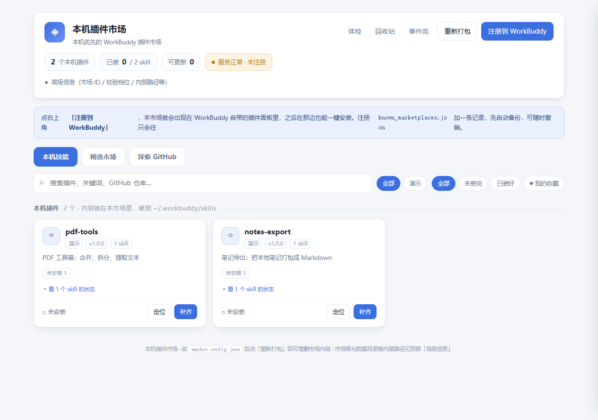
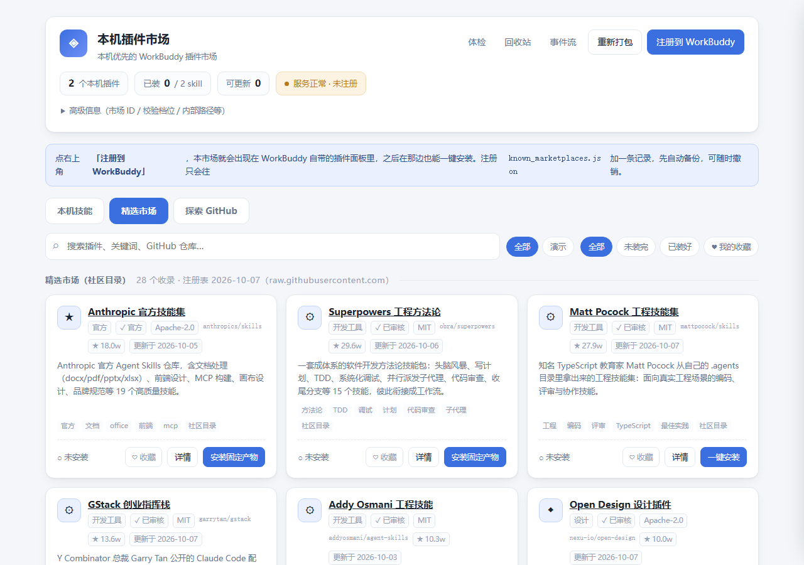
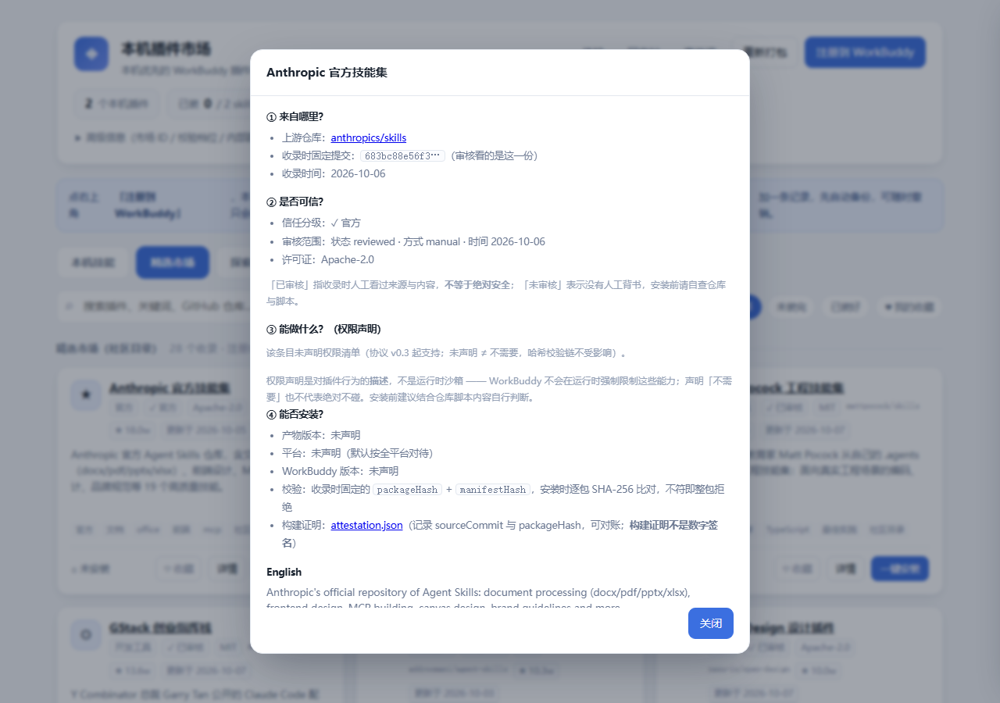

# WorkBuddy Market

[简体中文](README.md) · **English**

[](https://github.com/zjs105910/workbuddy-market/actions/workflows/ci.yml)
[](pyproject.toml)
[](LICENSE)

**A local-first plugin marketplace for WorkBuddy.** Package local Skills as plugins, browse a curated community registry or search public GitHub repositories, review declared permissions and compatibility, and manage installs, updates, and removals through hash verification and recoverable transactions.

## What it does

- **Package your own Skills** and register the marketplace in WorkBuddy's plugin panel.
- **Discover community Skills** through a curated registry and a GitHub search view.
- **Review before installing**: inspect source, declared permissions, compatibility, and package details.
- **Recover from mistakes**: transaction recovery and a trash area help protect managed Skills during updates and uninstalls.
- **Keep local data local**: the web UI binds to `127.0.0.1`; personal market configuration and local Skill contents are not meant to be committed to this repository.

## Quick start (Windows)

Requirements: Python 3.10+ and Git.

To try the web UI first without registering the marketplace in WorkBuddy:

```powershell
git clone https://github.com/zjs105910/workbuddy-market.git
cd workbuddy-market
.\安全模式-只开网页.cmd
```

The local web UI uses `http://127.0.0.1:8777/` by default. Keep the terminal window open while using it; press `Ctrl+C` in that window to stop the server.

When you are ready to integrate with WorkBuddy, run `一键启动.cmd`. On first-run setup, pressing Enter selects browse-only mode; choose option `2` explicitly to request registration. Packaging and self-check prerequisites still apply.

The launch scripts have Chinese filenames. You can also start from PowerShell with `python launcher.py --no-register` to open the web UI without registering it.

## Screenshots

| Local Skills | Curated marketplace |
| --- | --- |
|  |  |

Permission and compatibility details shown before installation:



> Screenshots are captured with synthetic data. Available actions and results depend on your local environment and the source plugin.

## Demo video and formal releases

- [Reproducible demo: recording steps, subtitles, and privacy boundaries](docs/demo-video.md)
- [Formal Release process](docs/release-process.md)
- [Watch or download the current demo build (about 80 seconds, MP4 + Chinese subtitles)](https://github.com/zjs105910/workbuddy-market/actions/runs/38121812213) (Actions artifact expires in 30 days).

Tagged app releases will include the MP4 demo, Chinese subtitles, Python wheel/sdist, and SHA-256 checksums on [GitHub Releases](https://github.com/zjs105910/workbuddy-market/releases). The current demo is a temporary artifact; releases named `registry-artifacts-*` contain community plugin artifacts, not the marketplace application itself.

## Safety notes

- The marketplace checks ownership and content changes before removing a managed Skill; Skills installed elsewhere are not supposed to be removed by this marketplace.
- **Declared permissions and a risk preview are not a runtime sandbox.** Third-party Skills can still execute their own logic. Review their source and origin before installation.
- `安全模式-只开网页.cmd` is for browsing without registering the marketplace. `撤销注册.cmd` removes the marketplace registration from WorkBuddy; this is different from uninstalling Skills.

## Platform status

| Platform | Status |
| --- | --- |
| Windows 10/11 | Primary development and use environment; the repository documents a WorkBuddy 5.7.6 panel test |
| Linux | CI and partial automated checks; real WorkBuddy host integration is not verified |
| macOS | Not verified |

## Documentation and community

- [Detailed usage, configuration, CLI, architecture and self-check commands](ADVANCED_GUIDE.md)
- [FAQ](docs/FAQ.md)
- [Plugin package specification](docs/plugin-spec.md)
- [Security policy](SECURITY.md)
- [Contributing guide](CONTRIBUTING.md)
- [Changelog](CHANGELOG.md)
- [Report a bug or suggest an improvement](https://github.com/zjs105910/workbuddy-market/issues)

Feedback, reproducible bug reports, documentation improvements, and pull requests are welcome. Licensed under MIT.
